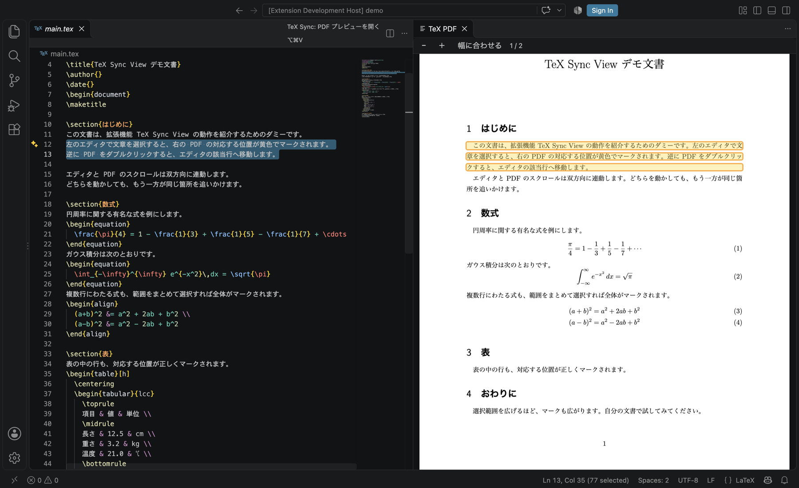
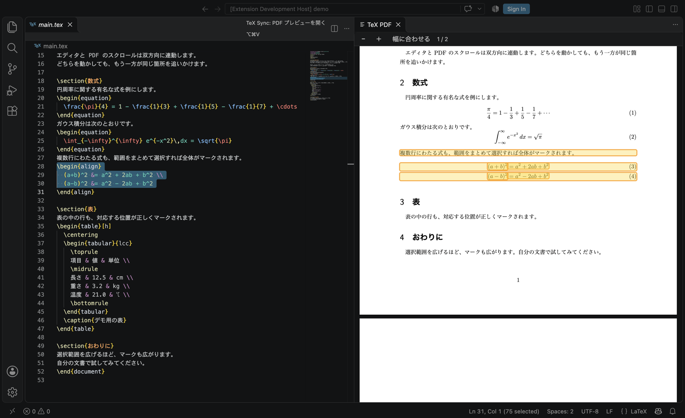

# TeX Sync View

VS Code 用の TeX 専用 PDF プレビュー拡張。`latex` / `tex` ファイルのときだけ動き、他の言語では何もしない。

- tex で選択した範囲(カーソルだけでも可)に対応する PDF 上の位置を黄色でマークする(SyncTeX)
- tex と PDF のスクロールを双方向に連動させる
- PDF を Cmd/Ctrl+クリック、またはダブルクリックすると、tex の該当行へジャンプする
- 保存時に `latexmk` でビルドする(LaTeX Workshop が自動ビルドしている場合はそちらに任せる)
- 出力先・ビルド引数は、既存の LaTeX Workshop の設定(`latex-workshop.latex.outDir` / `latex.recipes`)をそのまま使う





LaTeX Workshop とは併用できる。補完・アウトライン・エラー表示などの編集支援は LaTeX Workshop に任せ、この拡張は「PDF 表示とマーク、スクロール連動」だけを足す。

## 必要なもの

- VS Code(または VSCodium / Insiders)と、`code` コマンド
- TeX 環境に含まれる `latexmk` と `synctex`
- `-synctex=1` はビルド側で有効にしておく(`~/.latexmkrc` に書くか、LaTeX Workshop のレシピに入れる)

## 導入

```bash
git clone https://github.com/fatcorn753/tex-sync-view
cd tex-sync-view
./scripts/install.sh
```

Windows(PowerShell。実機では未検証):

```powershell
powershell -ExecutionPolicy Bypass -File scripts\install.ps1
```

導入後、VS Code で「Developer: Reload Window」を実行する。

`install.sh` は、導入の前に現在のユーザー設定(`settings.json`、`keybindings.json`、`snippets/`、拡張の一覧)を `~/.tex-sync-view-backup/<日時>/` へ保存する。設定ファイルは書き換えない。`.vsix` を同梱していない場合はソースから自動でビルドする(`zip` か `python3` が必要)。`--dry-run` を付けると何も変更せず手順だけ表示する。

`.vsix` だけが手元にある場合は、`./scripts/install.sh --vsix tex-sync-view-0.1.0.vsix` か、VS Code の「VSIX からのインストール」でも入る。

## 元に戻す

```bash
./scripts/restore.sh              # 拡張をアンインストールするだけ(設定ファイルは触らない)
./scripts/restore.sh --settings   # さらに設定を導入前のバックアップへ戻す
```

`--settings` は、導入後に自分で行った設定変更も巻き戻す。戻す直前の状態は `settings` と同じフォルダの `.tex-sync-view-before-restore-<日時>/` に退避する。何も変更せず確認したいときは `--dry-run`、古いバックアップを使うときは `--backup <フォルダ>`。

Windows: `scripts\restore.ps1 [-Settings] [-Backup DIR] [-DryRun]`

導入済みの状態で `install.sh` を再実行すると更新になり、導入前のバックアップは上書きしない。

## 使い方

tex ファイルを開き、`Cmd+Option+V`(Windows/Linux は `Ctrl+Alt+V`)、またはエディタ右上のボタンで PDF を開く。

| 設定 | 既定 | 内容 |
| --- | --- | --- |
| `texSync.rootFile` | 空 | ルート tex。空なら `%!TEX root`、`\documentclass` を含むファイル、`main.tex` の順で判定 |
| `texSync.outDir` | 空 | 出力先。空なら `latex-workshop.latex.outDir` を使う |
| `texSync.latexmkArgs` | 空 | 空なら LaTeX Workshop の先頭レシピ(latexmk)の引数を使う |
| `texSync.buildOnSave` | `auto` | `auto`: LaTeX Workshop が自動ビルド中なら任せる / `always` / `never` |
| `texSync.scrollSync` | `true` | スクロール連動 |
| `texSync.markSelection` | `true` | 選択範囲のマーク |
| `texSync.maxMarkLines` | `80` | 範囲マークで SyncTeX を引く最大行数 |

## 既知の制限

- PDF ビューアには、テキストの選択・コピー・検索、目次、サムネイル、ハイパーリンクの追従がない
- LaTeX Workshop 自身の PDF ビューアと同時に開くと、PDF が 2 つ並ぶ。どちらか一方を使う
- 動作確認は macOS + `uplatex` / `dvipdfmx`(`~/.latexmkrc` 経由)で行った。Linux・Windows と他の TeX エンジンは未確認

## 試してみる

`examples/demo/` に動作確認用のダミー文書(`main.tex`)がある。VS Code で開いて `Cmd+Option+V`、本文や数式を選択して PDF 側のマークを確認する。

## 開発

`test/runner.js` は、`--user-data-dir` と `--extensions-dir` を一時フォルダにした隔離状態の VS Code で、この拡張を開発版として読み込む(macOS。`CODE_APP` で本体、`TESTFILE` で `test/` 内の試験スクリプトを指定)。`test/shot.js` は README 用の画面撮影の手順。普段の VS Code には触れない。

## ライセンス

MIT。`media/pdfjs/` に同梱している pdf.js は Apache-2.0(`media/pdfjs/LICENSE`)。
